<!-- Graphics are generated by assets/generate.py; the activity micrograph is redrawn by .github/workflows/activity.yml. -->

<a href="https://ashtonlong.github.io/">
  <picture>
    <source media="(max-width: 600px)" srcset="assets/hero-mobile.svg" />
    
  </picture>
</a>

I'm a fourth-year Computer Science co-op student at the University of Guelph. Since May I've been a contract developer at [ScanAir](https://scanair.ca), building a drone mission planner. Before that I did a co-op term at Ontario's Ministry of Public and Business Service Delivery and Procurement, where I built a semantic search tool over past incidents so the team could find how something was fixed the last time it broke.

I'm looking for a software developer co-op for my next work term. [Email me](mailto:ashtonlonger07@gmail.com), or find me on [LinkedIn](https://www.linkedin.com/in/ashton-longer/) and my [portfolio](https://ashtonlong.github.io/). When I'm not at a keyboard I'm usually at the gym.

## Projects

<a href="https://github.com/AshtonLong/fruitfly-brain-mod">
  <picture>
    <source media="(max-width: 600px)" srcset="assets/projects/fruitfly-mobile.svg" />
    
  </picture>
</a>

**[Fruit Fly: A Small Mind](https://github.com/AshtonLong/fruitfly-brain-mod)** is a spiking neural simulation of a fruit fly, wired with real FlyWire connectivity. It runs as a Minecraft Fabric mod with ecology and a live view of brain activity.

`Java` `Fabric` `Python`

<a href="https://github.com/AshtonLong/AnkiGPT">
  <picture>
    <source media="(max-width: 600px)" srcset="assets/projects/ankigpt-mobile.svg" />
    
  </picture>
</a>

**[AnkiGPT](https://github.com/AshtonLong/AnkiGPT)** uses an agent pipeline to turn notes and PDFs into editable Anki decks. It checks every card against the source, merges near-duplicates, audits coverage, and rewrites the cards you keep failing using your imported review history.

`Python` `Flask` `OpenRouter` `NumPy` `SQLite`

<a href="https://scanair.ca">
  <picture>
    <source media="(max-width: 600px)" srcset="assets/projects/scanair-mobile.svg" />
    
  </picture>
</a>

**[ScanAir](https://scanair.ca)** is a drone mission planner. A FastAPI backend, a React and TypeScript frontend on Mapbox GL, and a Python geometry engine turn a scan area into DJI-ready waypoint missions for 3D Gaussian Splatting capture, with terrain checks.

`FastAPI` `React` `TypeScript` `Mapbox GL`

## Toolkit

Python and TypeScript are what I reach for first. I write a lot of my code with Claude Code or Codex in the loop.

<table>
  <tr><th align="left">Languages</th><td>Python, TypeScript, JavaScript, C, C++, Java, HTML, CSS, R</td></tr>
  <tr><th align="left">Frameworks</th><td>React, FastAPI, Flask, Vite</td></tr>
  <tr><th align="left">Tools and data</th><td>Docker, Git, GitHub Actions, SQLite, Redis</td></tr>
  <tr><th align="left">Editors</th><td>VS Code, PyCharm, IntelliJ, CLion</td></tr>
</table>

## Activity

<picture>
  <source media="(max-width: 600px)" srcset="https://raw.githubusercontent.com/AshtonLong/AshtonLong/output/activity-mobile.svg" />
  
</picture>

The micrographs are generated, not imaged. Activity is my real contribution calendar, redrawn every hour.
